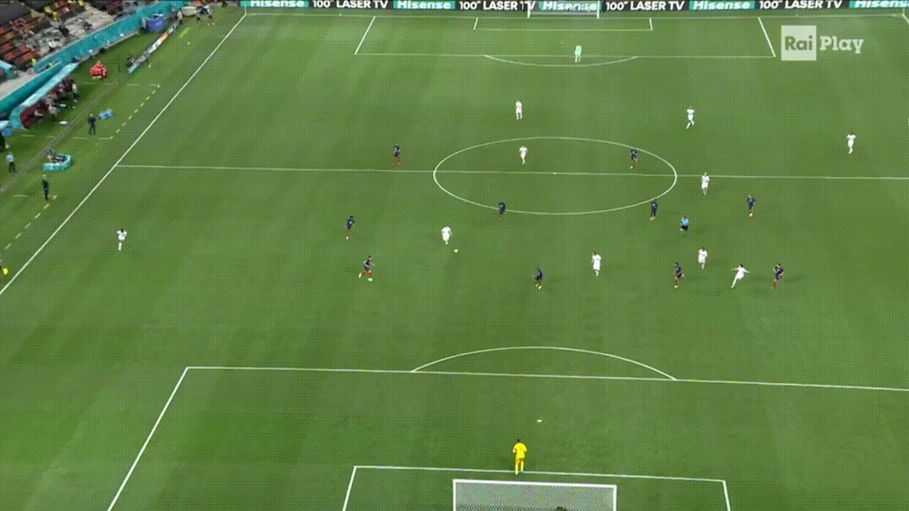
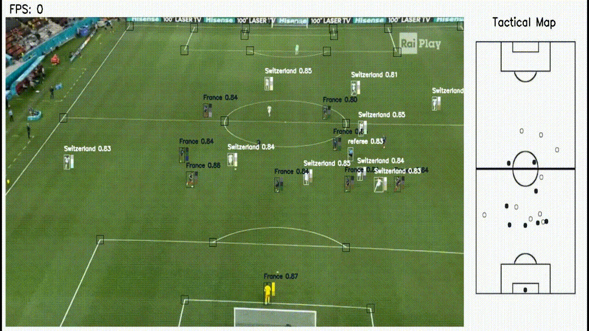

# Football Match Analysis with Tactical Map

[](https://football-tactical-map-analysis.streamlit.app/)
[](https://github.com/Asmit-123/football-tactical-map/actions/workflows/ci.yml)


**Live demo:** https://football-tactical-map-analysis.streamlit.app/

> The free host puts the app to sleep when nobody has visited for a while, so the first load can take about a minute.

A web app that analyses football footage from a tactical camera. It detects the players, referees
and ball, works out which team each player belongs to, and projects everyone onto a 2D tactical
map of the pitch, frame by frame.

> Works only with tactical camera footage (a wide view of the whole pitch).

## Features

- Detection of players, referees and the ball with two YOLOv8 models.
- Team prediction from the colour of each player's jersey, with a colour picker to set up the kits.
- Players and ball placed on a tactical map using a homography estimated from detected pitch keypoints.
- Ball tracking with a short path drawn on the map.
- Adjustable hyperparameters and annotation options, two built-in demo videos, and video upload.
- Downloadable annotated output video.

## How it works

1. **Detection.** A YOLOv8 model finds players, referees and the ball. A second YOLOv8 model finds
   28 landmarks on the pitch (corners, penalty-box corners, centre circle and so on).
2. **Homography.** The detected landmarks are matched with their known positions on a 2D pitch
   image to compute the transformation from the video frame to the tactical map. It is only
   recomputed when the landmarks have moved more than a set tolerance, which keeps the map steady.
3. **Position on the map.** The bottom-centre of each player's box (the feet) and the centre of the
   ball are transformed onto the tactical map.
4. **Team prediction.** The torso area of each player's box is reduced to its dominant colours.
   Each colour votes for the closest of four reference colours (player and goalkeeper kit of each
   team) in L\*a\*b\* colour space, and the majority decides the team.
5. **Ball tracking.** Recent ball positions are kept as a track, which is reset after too many
   frames without the ball or when the ball jumps too far between detections.

## Using the live demo

1. Pick **Demo 1** or **Demo 2** in the sidebar, or upload your own tactical-camera clip.
2. On the **Team Colors** tab, pick a frame where players of both teams are visible, then click a player to set each team's player and goalkeeper colours.
3. On the **Model Hyperparameters & Detection** tab, set **Process every Nth frame** to 3 or more (the free host is a small shared CPU) and click **Start Detection**.
4. When it finishes, use **Download result video**.

## Tech stack

Python, PyTorch, Ultralytics YOLOv8, OpenCV, scikit-image, NumPy, Streamlit, pytest, ruff,
GitHub Actions, Git LFS, Streamlit Community Cloud.

## Run locally

Requires Python 3.10 or newer (developed on 3.14).

```bash
git lfs install
git clone https://github.com/Asmit-123/football-tactical-map.git
cd football-tactical-map
python -m venv .venv
.venv\Scripts\activate          # Windows   (macOS/Linux: source .venv/bin/activate)
pip install -r requirements-dev.txt
pip install -e .
streamlit run app.py
```

The model weights (`models/`) and demo videos (`assets/demo/`) are stored with Git LFS, so run
`git lfs install` before cloning.

## Project layout

```
app.py                      Streamlit entry point
src/footballmap/
  config.py                 paths, default hyperparameters, demo presets
  models.py                 loads the two YOLO models
  homography.py             frame -> tactical map transformation
  teams.py                  team prediction from jersey colours
  ball.py                   ball track history
  annotate.py               drawing helpers
  pipeline.py               analyse + render a frame, run a whole video (no Streamlit)
  video.py  colorpick.py    video I/O and colour-picking helpers
  ui/                       Streamlit pages (sidebar, tabs, runner)
assets/                     tactical map image, keypoint positions, class names, demo videos
models/                     YOLO weights (Git LFS)
tests/                      pytest suite
docs/manual-test-checklist.md
```

## Tests and CI

```bash
pytest -m "not slow"     # fast unit tests, no models needed
pytest                   # also starts the whole app once (needs weights + demo video)
ruff check .             # lint
```

GitHub Actions runs the linter and the fast tests on every push. Manual checks are listed in
[docs/manual-test-checklist.md](docs/manual-test-checklist.md).

## Engineering notes

This is a rebuild of an earlier prototype with the same behaviour and a cleaner structure:

- The processing core (`pipeline.py`) has no Streamlit code, so it can be tested and reused. Analysis and drawing are separate steps.
- Homography, team prediction and ball tracking are small, separately tested modules.
- 62 automated tests, with the YOLO models replaced by fakes so most tests run in seconds.
- Fixed bugs from the prototype: the ball-track length cap never applied, the colour tab crashed with fewer than two players, the homography crashed when the first frame had too few keypoints, the saved video had its width and height swapped, uploads were rewritten to disk on every rerun, and file paths only worked on Windows.
- Deployment uses CPU-only PyTorch and the weights are tracked with Git LFS.

## Limitations

- Needs tactical-camera footage; close-up broadcast shots won't produce a usable map.
- The hosted demo runs on a small shared CPU, so processing is slow compared with a GPU.
- The output video uses the MPEG-4 codec, which some browsers can't play. Open the downloaded
  file in VLC or a media player.

## Application Workflow

The journey of the input video and different functionalities are illustrated in the workflow diagram below.


## Demo Input

<p></p>


## Demo Output

<p></p>
